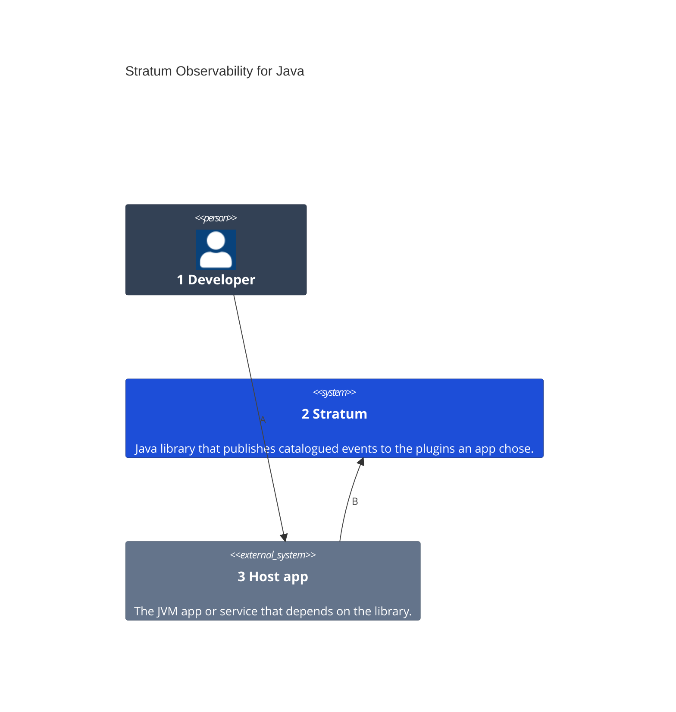
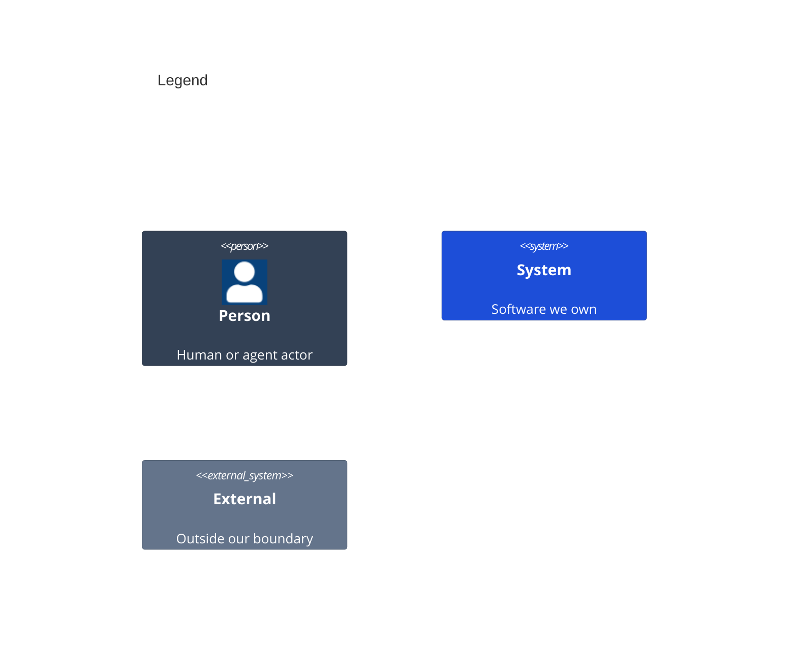

# System Context

Numbers on nodes and letters on arrows match the callout table.

| #   | Description | Why |
| --- | --- | --- |
| 1   | Writes an app, its catalog of events, and the plugins it publishes to. | Requirements name this actor in a Given. |
| 2   | The `stratum-core` library and the plugin modules built on it. | One way to publish, whatever the destination. |
| 3   | The app a person uses, which depends on the library. | Events start from what a person does there. |
| A   | The developer builds the app with the library. | The app chooses its catalogs and plugins. |
| B   | The app publishes events by key. | One call per event, checked against the catalog. |
