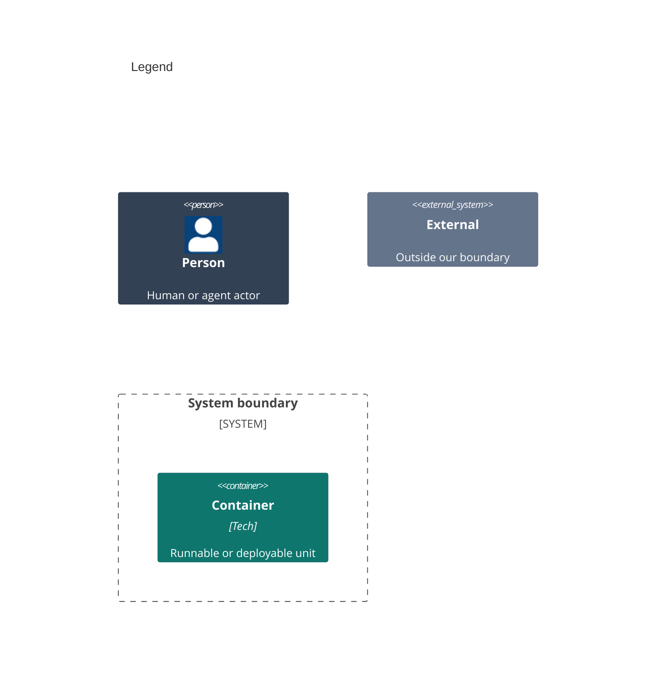

# Containers

A container here is an app that runs on its own. Stratum ships only library modules, and they run inside the host app's process, so [03-components.md](03-components.md) shows them. This repo builds no container of its own.

```mermaid
C4Container
    title Stratum Observability for Java

    Person(dev, "1 Developer")

    System_Boundary(stratum, "2 Stratum") {
    }

    System_Ext(app, "3 Host app", "The JVM app or service that depends on the Stratum modules and runs them.")

    Rel(dev, app, "A")

    UpdateElementStyle(dev, $bgColor="#334155", $borderColor="#1e293b", $fontColor="#ffffff")
    UpdateElementStyle(app, $bgColor="#64748b", $borderColor="#475569", $fontColor="#ffffff")
```



Numbers on nodes and letters on arrows match the callout table.

| #   | Description | Why |
| --- | --- | --- |
| 1   | The developer from the system context. | Every run starts with this actor. |
| 2   | The Maven build that the root `pom.xml` declares. | Its modules are libraries, not apps. |
| 3   | The app that depends on `stratum-core` and the plugin modules it uses. | Stratum runs in its process, on its threads. |
| A   | The developer adds the modules to the app's build. | The app owns its catalogs and its plugins. |
