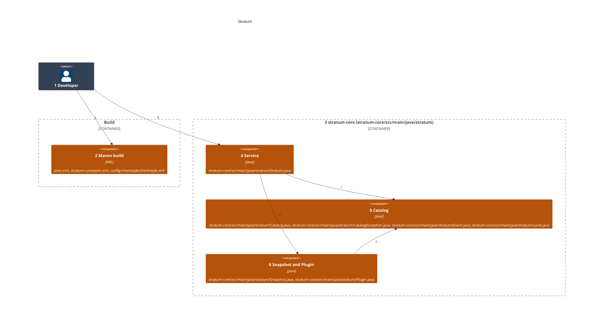
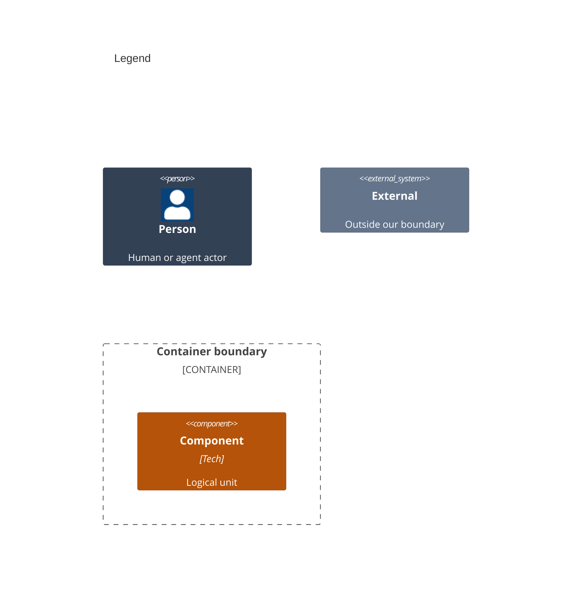

# Components

This splits the library modules that run inside the host app of [02-containers.md](02-containers.md) into the files that build them.

Numbers on nodes and letters on arrows match the callout table.

| #   | Description | Why |
| --- | --- | --- |
| 1   | The developer, whose app depends on the modules and calls the service. | Every run starts with this actor. |
| 2   | The root `pom.xml` lists the modules and pins Java 21, the module pom builds `stratum-core`, and the Checkstyle config holds the thresholds. | An app depends only on the modules it uses. |
| 3   | The core module, from `stratum-core/src/main/java`. | Catalogs, context and publishing, with no plugin of its own. |
| 4   | `Stratum` holds catalogs, plugins, context and listeners behind one lock, and publishes. | Safe to call from any thread. |
| 5   | `Catalog`, `CatalogException`, `Event` and `Level`. | An event names its category, level and allowed fields. |
| 6   | `Snapshot` and the `Plugin` interface. | Every plugin and listener reads one frozen value. |
| A   | The app adds the modules to its build. | A Maven or Gradle dependency. |
| B   | The app adds catalogs and plugins, and publishes. | One service per product. |
| C   | The service checks each catalog's events. | A bad key fails when it is added, not when it is used. |
| D   | The service freezes each event into a snapshot for its plugins. | A later context change never reaches it. |
| E   | A snapshot carries the level of the event it froze. | Plugins read the category and level from it. |
