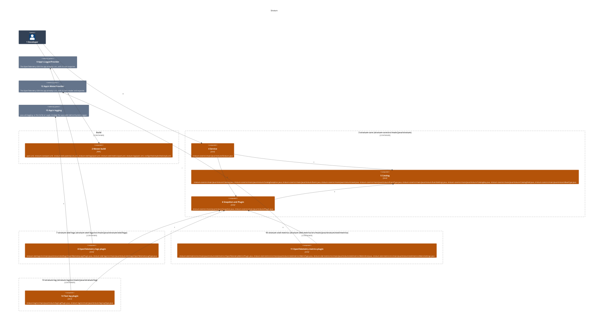
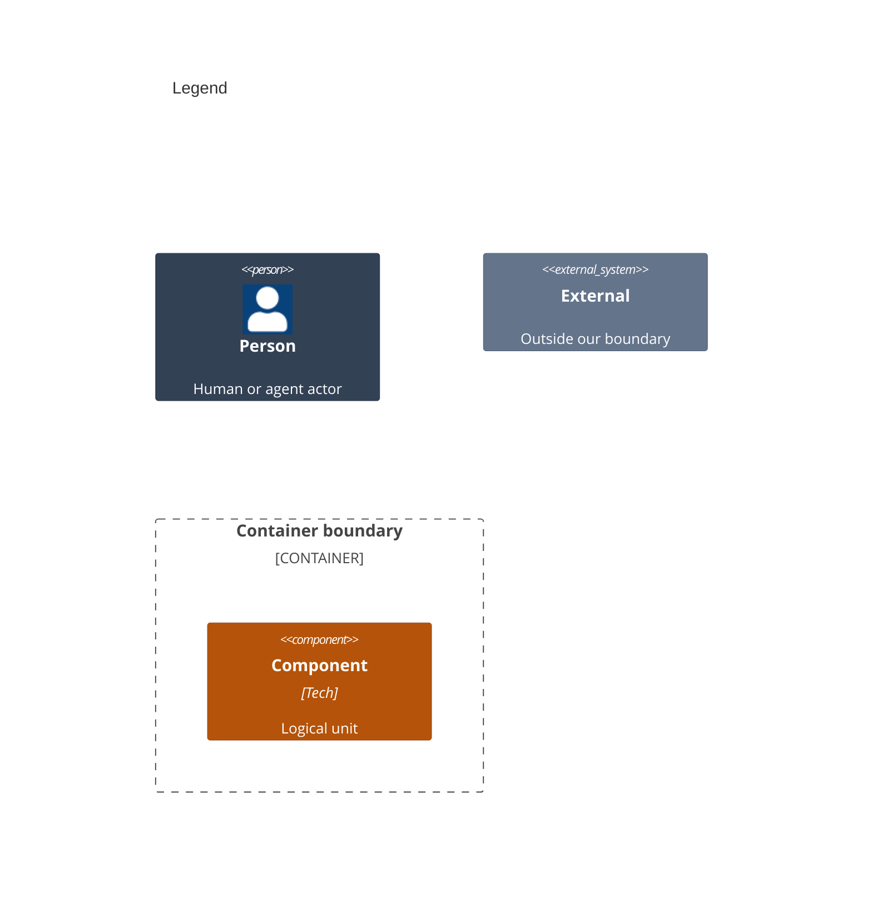

# Components

This splits the library modules that run inside the host app of [02-containers.md](02-containers.md) into the files that build them.

Numbers on nodes and letters on arrows match the callout table.

| #   | Description | Why |
| --- | --- | --- |
| 1   | The developer, whose app depends on the modules and calls the service. | Every run starts with this actor. |
| 2   | The root `pom.xml` lists the modules and pins Java 21, each module pom builds one module, and the Checkstyle config holds the thresholds. | An app depends only on the modules it uses. |
| 3   | The core module, from `stratum-core/src/main/java`. | Catalogs, context and publishing, with no plugin of its own. |
| 4   | `Stratum` holds catalogs, plugins, context and listeners behind one lock, and publishes. | Safe to call from any thread. |
| 5   | `Catalog`, `CatalogException`, `Event`, `Level`, `EventType`, `EventSettings`, `CatalogKey`, `CatalogField` and `BaseType`. | Each catalog entry names its type, description, id, level, fields and settings. |
| 6   | `Snapshot` and the `Plugin` interface, with the types each plugin accepts. | Every plugin and listener reads one frozen value. |
| 7   | The OpenTelemetry logs module, from `stratum-otel-logs/src/main/java`. | Only apps that run OpenTelemetry pull in its API. |
| 8   | `OpenTelemetryLogsPlugin` accepts the `LOG` event type and emits each such snapshot as a log record, with private fields hidden. | Events join the pipeline the app already runs. |
| 9   | The `LoggerProvider` the app passes in, with the exporter it chose. | The plugin owns no endpoint of its own. |
| 10  | The OpenTelemetry metrics module, from `stratum-otel-metrics/src/main/java`. | It shares no code with the logs module beyond core. |
| 11  | `OpenTelemetryMetricsPlugin` records each snapshot with the `MetricType.METRIC` type through the instrument its `MetricSettings` name. | Only public fields become attributes. |
| 12  | The `MeterProvider` the app passes in, with the reader and exporter it chose. | The app decides where measurements go. |
| 13  | The text log module, from `stratum-log/src/main/java`. | It needs nothing beyond the JDK. |
| 14  | `LogPlugin` accepts the `LogType.LOG` event type and writes each such snapshot as one text line, with private fields hidden. | A team sees its events with no server. |
| 15  | The backend behind `System.Logger` that the app runs. | The app decides where lines go. |
| A   | The app adds the modules to its build. | A Maven or Gradle dependency. |
| B   | The app adds catalogs and plugins, and publishes. | One service per product. |
| C   | The service and each plugin check every catalog it adds. | A bad key or setting fails when it is added, not when it is used. |
| D   | The service freezes each event into a snapshot for its plugins. | A later context change never reaches it. |
| E   | A snapshot carries the level, types and settings of the event it froze. | Plugins read what to send from it. |
| F   | The OpenTelemetry logs plugin reads each snapshot it accepts. | Its record holds the same frozen value. |
| G   | The OpenTelemetry logs plugin emits the record through the app's provider. | The app decides where records go. |
| H   | The metrics plugin reads each snapshot it accepts. | The catalog, through each event's types, decides what it takes. |
| I   | The metrics plugin records the value through the app's meters. | A value that is not a number records nothing. |
| J   | The text log plugin reads each snapshot it accepts. | Its line holds the same frozen value. |
| K   | The text log plugin writes the line to the logger named for the product. | Lines sit beside the app's own. |
