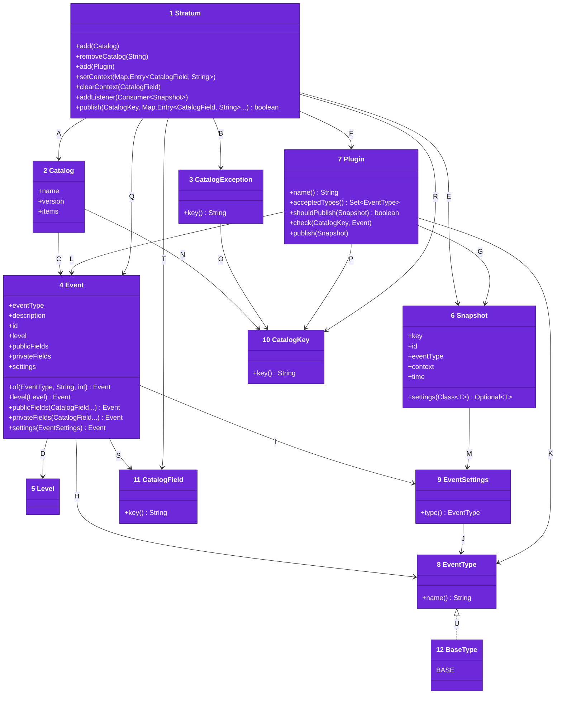
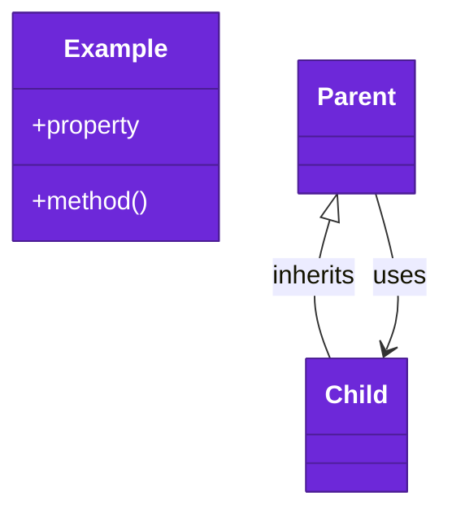

# Code

The types an app uses, from [03-components.md](03-components.md). The root `pom.xml` builds every module for Java 21, with no runtime dependency.

Numbers on classes and letters on relationships match the callout table.

| #   | Description | Why |
| --- | --- | --- |
| 1   | `Stratum` in [Stratum.java](../../stratum-core/src/main/java/stratum/Stratum.java), the engine an app publishes through, usually one shared constant. | One final class, safe from any thread. |
| 2   | `Catalog` in [Catalog.java](../../stratum-core/src/main/java/stratum/Catalog.java), a named and versioned map of events by key, declared as a constant in its own file. | A reader sees the whole catalog in one file. |
| 3   | `CatalogException` in [CatalogException.java](../../stratum-core/src/main/java/stratum/CatalogException.java), an invalid event or a duplicate key or id. It is unchecked. | The engine can be a static constant and still fail at start. |
| 4   | `Event` in [Event.java](../../stratum-core/src/main/java/stratum/Event.java), one catalog item with its type, description, id, level, fields and settings. | The id is the reference that queries find the event by. |
| 5   | `Level` in [Level.java](../../stratum-core/src/main/java/stratum/Level.java), from debug to fault. | Each plugin maps it onto its own scale. |
| 6   | `Snapshot` in [Snapshot.java](../../stratum-core/src/main/java/stratum/Snapshot.java), one published event with its context, product and time. | Plugins never read live state. |
| 7   | `Plugin` in [Plugin.java](../../stratum-core/src/main/java/stratum/Plugin.java), a destination with a name and the types it accepts. | A second plugin with the same name replaces the first. |
| 8   | `EventType` in [EventType.java](../../stratum-core/src/main/java/stratum/EventType.java), a type an event can have. | Plugin modules define their own types, and two types with the same name match. |
| 9   | `EventSettings` in [EventSettings.java](../../stratum-core/src/main/java/stratum/EventSettings.java), the extra attributes for one type. | Only the plugin module that defines them reads them. |
| 10  | `CatalogKey` in [CatalogKey.java](../../stratum-core/src/main/java/stratum/CatalogKey.java), which the app's key enum implements, each constant with its key text. | A key typed as text does not compile, and renaming a constant never changes telemetry. |
| 11  | `CatalogField` in [CatalogField.java](../../stratum-core/src/main/java/stratum/CatalogField.java), which the app's field enum implements, each constant with its field text. | A field typed as text does not compile. |
| 12  | `BaseType` in [BaseType.java](../../stratum-core/src/main/java/stratum/BaseType.java), the built-in event type. | Events that need no plugin attributes use `BASE`. |
| A   | The engine holds catalogs and checks each one it adds. | Every key and id is checked once. |
| B   | A bad event, or a key or id another event holds, throws a `CatalogException`. | The developer reads which event to fix. |
| C   | A catalog maps each key to its event. | One entry per key. |
| D   | An event has one level. | Plugins read it to filter and to map. |
| E   | Publishing builds one snapshot. | Listeners and plugins share it. |
| F   | The engine hands the snapshot to each plugin that accepts its type and whose `shouldPublish` returns true. | A plugin can take only some events. |
| G   | A plugin receives snapshots. | It never sees the engine's state. |
| H   | An event has the type that decides the plugins it reaches. | An empty accepted list takes every type. |
| I   | An event may carry settings for its type. | Settings for another type fail when the catalog is added. |
| J   | Each settings value names its type. | The engine can check it matches the event. |
| K   | A plugin lists the types it accepts. | An empty list accepts every event. |
| L   | A plugin checks each event of a type it accepts. | A bad setting fails when it is added. |
| M   | A snapshot carries its event's settings. | A plugin reads its own settings by class. |
| N   | A catalog is keyed by the app's key constants. | Keys are never hard-coded strings. |
| O   | A refusal names the key of the event. | The developer reads which event to fix. |
| P   | A plugin's check receives the event's key. | Its refusal can name it. |
| Q   | The engine reads each key's event from its catalog. | Fields the event does not name are left out. |
| R   | The engine publishes by key constant. | An unknown key does not compile. |
| S   | An event declares its public and private fields by field constant. | The catalog lists every field once. |
| T   | The engine takes values and context as entries of a field constant and its text value. | A field typed as text does not compile. |
| U   | `BaseType` is an event type. | Its name matches any module's type named `BASE`. |

## Tests

`mvn verify` runs the `src/test/java` folder of `stratum-core`, `stratum-otel-logs`, `stratum-otel-metrics` and `stratum-log`, one JUnit class per requirement doc. Each test starts a real `Stratum` for the notes catalog and publishes as an app does. It reads what the plugin or listener received, or compiles app code with the JDK compiler.

The OpenTelemetry tests read records from an in-memory exporter and metrics from an in-memory reader. The text log tests read lines from a java.util.logging handler. JaCoCo holds line and branch coverage of each module at 100%.
