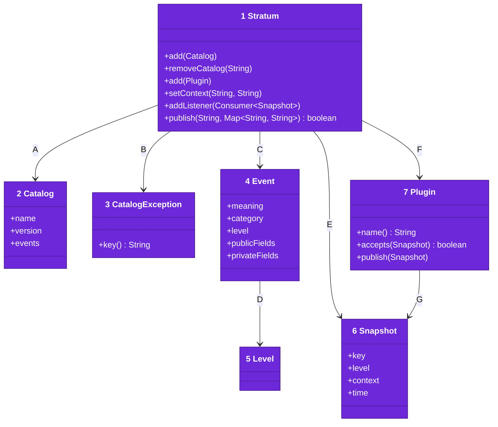
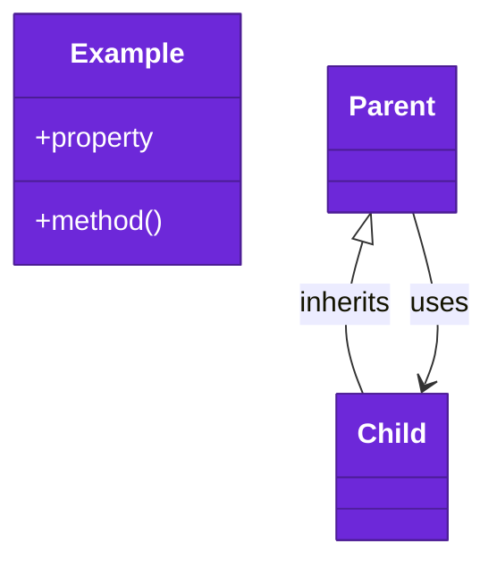

# Code

The types an app uses, from [03-components.md](03-components.md). The root `pom.xml` builds every module for Java 21, with no runtime dependency.

Numbers on classes and letters on relationships match the callout table.

| #   | Description | Why |
| --- | --- | --- |
| 1   | `Stratum` in [Stratum.java](../../stratum-core/src/main/java/io/github/mayjournal/stratum/Stratum.java), the service an app publishes through. It also adds plugins and listeners. | One final class, safe from any thread. |
| 2   | `Catalog` in [Catalog.java](../../stratum-core/src/main/java/io/github/mayjournal/stratum/Catalog.java), a named and versioned set of events by key. | A key belongs to one catalog. |
| 3   | `CatalogException` in [CatalogException.java](../../stratum-core/src/main/java/io/github/mayjournal/stratum/CatalogException.java), an invalid event or a duplicate key. | Adding a catalog fails at once, naming the event. |
| 4   | `Event` in [Event.java](../../stratum-core/src/main/java/io/github/mayjournal/stratum/Event.java), with its category, level and allowed fields. | The category matches a logger name the app already uses. |
| 5   | `Level` in [Level.java](../../stratum-core/src/main/java/io/github/mayjournal/stratum/Level.java), from debug to fault. | Each plugin maps it onto its own scale. |
| 6   | `Snapshot` in [Snapshot.java](../../stratum-core/src/main/java/io/github/mayjournal/stratum/Snapshot.java), one published event with its context, product and time. | Plugins never read live state. |
| 7   | `Plugin` in [Plugin.java](../../stratum-core/src/main/java/io/github/mayjournal/stratum/Plugin.java), a destination with a name. | A second plugin with the same name replaces the first. |
| A   | The service holds catalogs and checks each one it adds. | Every key is checked once. |
| B   | A bad or duplicate key throws a `CatalogException`. | The developer reads which event to fix. |
| C   | The service reads each key's event from its catalog. | Fields a key's event does not name are dropped. |
| D   | An event has one level. | Plugins read it to filter and to map. |
| E   | Publishing builds one snapshot. | Listeners and plugins share it. |
| F   | The service hands the snapshot to each plugin that accepts it. | A plugin can take only some events. |
| G   | A plugin receives snapshots. | It never sees the service's state. |

## Tests

`mvn verify` runs `stratum-core/src/test/java`, one JUnit class per requirement doc. Each test starts a real `Stratum` for the notes product, publishes as an app does, and reads what the plugin or listener received. JaCoCo holds line and branch coverage of the module at 100%.
