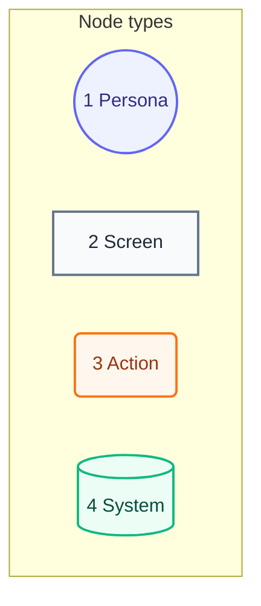
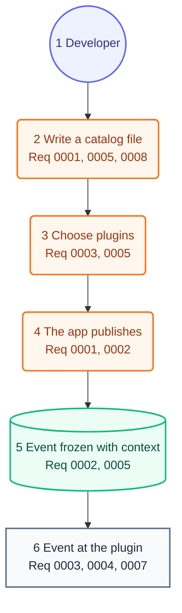

# User Journey

## Legend

Numbers match the callout table.

| #   | Description | Why |
| --- | ----------- | --- |
| 1   | Persona     | A person the system context declares. |
| 2   | Screen      | What the person sees. |
| 3   | Action      | What the person does. |
| 4   | System      | What the product does in reply. |

## Journey

Numbers match the callout table.

| #   | Description | Type | Why |
| --- | ----------- | ---- | --- |
| 1   | The developer. | Persona | Same person as the system context. |
| 2   | Writes the catalog as a constant in its own file: each key, its type, description, id, fields and settings. | Action | The app publishes by key constant, so an unknown key does not compile. |
| 3   | Adds the plugins the app sends events to. | Action | Each plugin takes only the event types it accepts. |
| 4   | A person uses the app, and its code publishes a key with an option for each field it fills. | Action | Events start from what a person does. |
| 5   | Stratum freezes the event with its context and product. | System | Every plugin reads the same value. |
| 6   | The developer reads the event where the plugin sent it, such as an OpenTelemetry log record or a text log line. | Screen | Private fields stay in the fields the plugin must keep private. |
